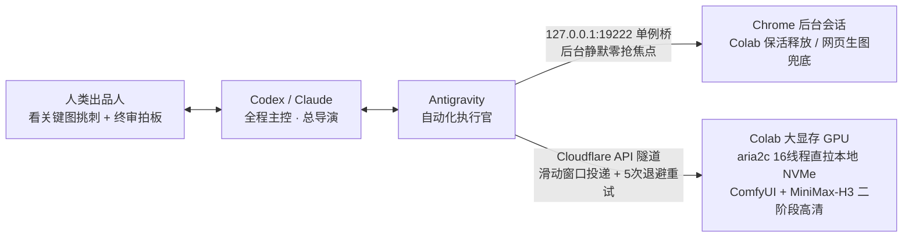

# AI Video Production & Four-Gate QA Pipeline
### 基于 `Codex/Claude (总导演)` + `Antigravity (全能执行官)` + `Colab NVMe + MiniMax-H3 (二阶段高清后端)` 的不限时长 AI 视频工业化生产线与四级质检体系

> **“很多人只教你怎么用 AI 做出几秒视频，却不教你做出来能不能看、能不能稳定交付几分钟的成片。”**
> 本仓库开源一套经过超长多镜头高难项目实战跑通的 **AI 视频工业化生产流程、ComfyUI 二阶段高清工作流与四级质量门禁（Gate 0 / A / B / C）代码套件**。
> **全场景通用**：不仅适用于动作参考复刻/MV，同样全面支持**原创剧情叙事短片、商业广告、动画番剧、概念短片（`T2VA / I2VA / FL2VA / Ref2VA` 全模式）**。

---

## 一、核心架构：一个各司其职的“AI 剧组”



- **主控总导演（Codex / Claude）**：负责剧本情绪弧线与分镜因果审定（Gate 0）、关键帧复审（Gate A）、单镜二次失败熔断根因诊断、成片终审签发（Gate C）。
- **全能执行官（Antigravity）**：接管 Colab API 极速部署、单线程生图修图（内置生图额度冷却时自动静默切换网页端 Gemini 续跑）、滑动窗口连续渲染、自动初筛与 18 帧抽检拼图、FFmpeg 原速合成与 GPU 下线核验。
- **云端摄影棚（Colab + MiniMax-H3 开源权重）**：按小时租用 A100 / H100 / RTX PRO 6000 Blackwell 大显存卡；**抛弃慢速 Google Drive 挂载读权重**，每次唤醒利用机房超千兆带宽用 `aria2c` 16 线程把模型秒级直拉进 `/content` 本地 NVMe 固态盘常驻显存。

---

## 二、把错误拦在烧钱之前：四级审核门禁与两级熔断

| 关卡 | 算力消耗 | 审核重点与省钱逻辑 |
|---|---|---|
| **Gate 0 · 剧本与分镜关** | **0 元** | 查四幕起伏弧线、前后镜视线/声音因果衔接（禁无征兆跳切）、180° 空间轴线统一、物理动作合理性（禁“笔碰纸却不出画”的干动作）、提示词完整性。 |
| **Gate A · 关键图关（最省钱命门）** | **极低** | Antigravity 自检 → Codex 复审 → **人工肉眼挑刺（只管看哪里不顺眼）**。锁死角色定妆卡色准、同镜关键帧**单一母版底图同源派生**（防摇移/拉远中途换景）、入画与 >90° 转身必补过渡帧。把 80% 废片消灭在开显卡之前！ |
| **Gate B · 单镜 18 格显微镜关** | **按镜受控** | 脚本自动查帧数/黑帧/冻结/跳切，但**严禁脚本自判“合格”**！每镜输出 `0.25s` 步长 18 格大图（大转身附 `3×` 局部放大图）由人工签字；触发**同镜同错 2 次镜头熔断 / 同类 3 镜流程熔断**立即停机改病根，绝不抽卡赌运气。 |
| **Gate C · 成片终审交付关** | **0 元（本地）** | 100% 镜头人工签合格后 1:1 原速无损拼接（禁变速凑时长）；输出**全片 0.5s 一帧身份大巡检图**、全部接缝前后 3 帧核验图、5 处重拍同步核验；签发后立即挂接页面释放 GPU 并验证隧道 `OFFLINE`。 |

---

## 三、仓库目录结构

```text
ai-video-production-pipeline/
├── standards/
│   └── universal-video-production-qa-standard.md   # 通用 AI 视频四级质检总标准 v2.0（含 31 条实战防翻车库）
├── workflows/                                      # 可直接拖入最新 ComfyUI 网页端或供 API 调用的工作流
│   ├── minimax_h3_2stage_i2v_fl2v.json             # 通用原创图生 / 首尾帧二阶段高清工作流 (832x480 -> 1792x992)
│   ├── minimax_h3_2stage_full_ref2va.json          # 多角色定妆卡 + 首/中/尾多锚点 + 动作参考二阶段高清工作流
│   └── minimax_h3_1stage_fast_probe.json           # 一阶段快速能力探针工作流
├── custom_nodes/
│   └── h3_pipeline_compat/__init__.py              # 云端配套节点：H3SigmaRefiner 余弦加密采样 + 智能显存/内存管理钩子
├── scripts/
│   ├── chrome_cdp_singleton_bridge.py              # 本地 19222 浏览器单例守护桥（零抢焦点）
│   ├── colab_nvme_bootstrap.py                     # Colab 专用本后台挂载 + aria2c 16线程本地 NVMe 极速部署
│   ├── release_colab_gpu.py                        # 挂接页面断开 Colab GPU + 隧道离线双重验证防偷跑扣费
│   ├── vocal_envelope_analyzer.py                  # 0.25s 音频人声能量时间窗提取器（驱动精准张闭嘴口型）
│   ├── batch_render_and_gate_b.py                  # 全文件预检 + 滑动窗口连续渲染 + 18格抽检拼图引擎
│   ├── mark_verified_shots.py                      # Gate B 人工逐格审核签字归档工具
│   └── build_master_and_gate_c.py                  # 1:1 原速母片合成 + Gate C 全片 0.5s 巡检与接缝核验生成器
├── prompts/
│   ├── CODEX_DIRECTOR_RULES.md                     # 给 Codex / Claude 主控总导演的系统规则模板
│   ├── ANTIGRAVITY_WORKER_RULES.md                 # 给 Antigravity 执行官的系统规则模板
│   └── SHOT_PROMPT_TEMPLATES.md                    # 通用十三段导演分镜模板 + MiniMax-H3 官方三段/六段模板
└── examples/
    └── atomic_shot_table.example.json              # 原子镜头表（唯一真相源）标准示例
```

---

## 四、快速上手流程

1. **挂载 Agent 规则**：将 `prompts/CODEX_DIRECTOR_RULES.md` 与 `prompts/ANTIGRAVITY_WORKER_RULES.md` 分别配置给你的主控与执行 Agent，并让它们开工前读取 `standards/universal-video-production-qa-standard.md`。
2. **完成 Gate 0 与 Gate A**：参照 `examples/atomic_shot_table.example.json` 编写分镜表与关键帧，人工挑刺确认所有关键图满意后，将镜头状态设为 `"关键图已审"`。
3. **启动单例桥与极速唤醒云端 GPU**：
   ```bash
   python scripts/chrome_cdp_singleton_bridge.py --port 19222
   python scripts/colab_nvme_bootstrap.py --notebook-id <你的固定Colab笔记本ID> --tunnel-file /path/to/project/current_tunnel.txt
   ```
4. **滑动窗口批量渲染与 Gate B 18 帧逐格审核**：
   ```bash
   python scripts/batch_render_and_gate_b.py --project-dir /path/to/project
   # 人工审阅 qa/GateB_单镜质检/*_18帧抽检.jpg 确认达标后签字归档：
   python scripts/mark_verified_shots.py --project-dir /path/to/project S01 S02
   ```
5. **合成母片、执行 Gate C 终审并释放云端 GPU**：
   ```bash
   python scripts/build_master_and_gate_c.py --project-dir /path/to/project --output-name Final_Master.mp4
   python scripts/release_colab_gpu.py --notebook-id <你的固定Colab笔记本ID> --tunnel-file /path/to/project/current_tunnel.txt
   ```

---

## 五、开源协议
本项目采用 [MIT License](LICENSE) 开源，欢迎自由使用、修改与在此基础上构建你自己的 AI 影视工业化工作流。
