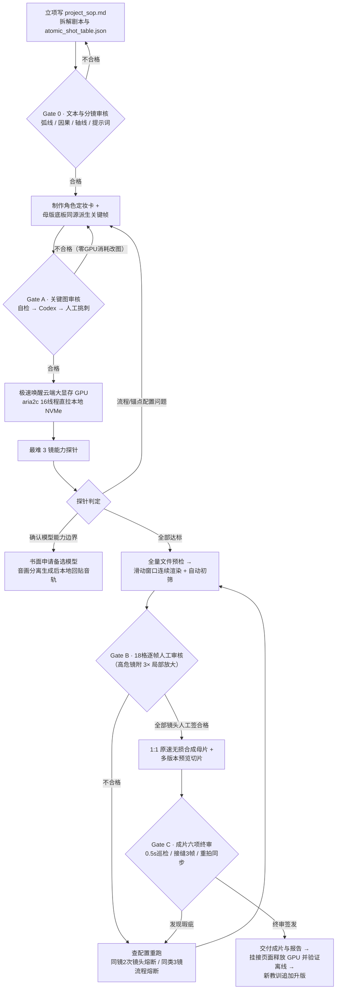

# AI 视频工业化生产与四级质检通用总标准（长期记忆 · 强制）

> 版本：2026-11-12 v2.0（升级为全场景通用版：统一覆盖“原创剧本分镜路径 `T2V/I2V/FL2V`”与“参考视频驱动路径 `Ref2V`”的四级门禁 `Gate 0 / Gate A / Gate B / Gate C`、两级熔断与 31 条实战防翻车规范）
> 适用：**所有**采用“主控 Agent（Codex/Claude）+ 执行 Agent（Antigravity）+ 云端/本地节点后端（ComfyUI + MiniMax-H3 / Wan / Seedance / Flow / Kling 等）”路径制作的视频项目——包括原创叙事短片、剧情片、商业广告、音乐 MV、教学片以及参考视频动作复刻/重演。
> 执行者：主控审核 Agent（Codex / Claude / OPUS）、执行 Agent（Antigravity）及其子 Agent。**任何视频项目开工前必须先完整读完本文件。**
> 标准文件位置：`standards/universal-video-production-qa-standard.md`

---

## 0. 总原则與角色分工

### 0.1 五条铁律
1. **先审后跑（越早拦截越省钱）**：剧本分镜没审过不出图（Gate 0）；关键图/锚点没审过不开 GPU（Gate A）；单镜视频没逐帧人工审过不叫合格（Gate B）；成片没终审不叫完成（Gate C）。
2. **证据说话**：每个“合格”结论都必须附逐项检查依据。**严禁**笼统写“100% 一致”“完美无瑕”。
3. **不合格置顶汇报**：所有缺陷与返修项必须放在汇报最前面，严禁挪到“后续优化”里淡化掩盖。
4. **先查流程再怪模型**：失败时先排查自己的剧本逻辑、锚点同源性、帧索引换算与提示词结构；排除全部流程问题并跑完能力探针（§7）后，才能归因为模型能力边界。
5. **默认否决项聚焦硬伤**：除非项目明确指定特定画风，默认一票否决项为：**动作与物理合理性、角色身份与造型一致性、空间轴线与机位连续性、时长与音画节奏、画面干净度（零穿帮/零乱码水印）**。

### 0.2 标准协同分工（主控大脑 + 自动化执行 + 云端算力）
| 角色 | 核心职责 | 权限红线 |
|---|---|---|
| **主控总导演（Codex / Claude）** | 审定剧本弧线与分镜因果（Gate 0）、复审关键帧对照图（Gate A）、单镜二次熔断根因诊断、成片终审签发（Gate C） | 不跑重复队列轮询与文件搬运；每次介入必须一锤定音 |
| **自动化执行官（Antigravity）** | 环境与本地 NVMe 模型极速部署、生图修图（含配额耗尽无缝切网页端备用生图）、滑动窗口投递、自动初筛与 18 帧抽检拼图、FFmpeg 合成、GPU 释放验证 | **脚本永远只准报“自动初筛通过”，严禁擅自标“合格”**；严禁抢前台窗口焦点 |
| **云端算力后端（Colab + ComfyUI）** | 挂载大显存 GPU 运行二阶段高清工作流（如 MiniMax-H3 全模式） | 禁用低配小显存卡；跑空或暂停 ≤10 分钟必须断开并验证离线 |
| **人类出品人** | 在关键图审核（Gate A）与成片交付前用肉眼挑刺“哪里不顺眼、哪里要改” | 免于繁琐命令行、排队等待与参数调试 |

---

## 1. 通用验收红线（R1–R9，立项时在 `project_sop.md` 填入具体参数）

| # | 红线 | 原创剧本分镜项目标准（无参考视频） | 参考视频驱动项目标准（有动作/运镜参考视频） |
|---|---|---|---|
| **R1 切点与衔接** | 镜头切换与时长严格遵循分镜表，前后镜动作/视线/声音因果咬合 | 切镜时间与参考视频误差 ≤ 2 帧 |
| **R2 景别与机位** | 景别、机位高度、推拉摇移方向严格符合分镜设计 | 景别、机位角度、运镜轨迹与参考视频一致 |
| **R3 动作与物理** | 按分秒时间轴发生真实运动，重心接触准确，动作必有对应物理结果；无站桩、慢放、倒放或吞动作 | 每 0.25s 对照：肢体方向、手部接触点、站位、转身时机一致 |
| **R4 主角身份** | 每个主角全程面孔、发型、服装款式（如领口/肩带有无）、配饰、肤色高度统一，**任何 1 帧不得变成他人** | 同左，且**任何 1 帧不得泄漏为参考视频原演员** |
| **R5 配角与群演** | 按项目设定出现或留空，边缘与背景虚焦区零多余幻觉人影 | 画面任何位置按设定替换或彻底清空，零原片路人/伴舞残肢 |
| **R6 干净画面** | 零台标、零乱码字幕、零水印、零平台角标（除非项目明确要求字幕） | 同左（参考源中的台标与字牌必须预先净化） |
| **R7 时长与原速** | 逐镜时长与分镜设计精确一致，1:1 原速；**严禁用 `setpts` 加速/慢放硬凑时长** | 逐镜帧数与参考切片严格 1:1 守恒，零变速 |
| **R8 零生成伪影** | 无同镜中途换背景、无首帧静止卡顿、无尾部闪回、无手部/躯干融化、无悬浮杂物 | 同左，且无跨切点融化 |
| **R9 空间轴线** | 严守 180° 轴线，同一场戏人物左右站位与视线朝向全片统一 | 保持参考视频的空间方位与左右关系，不得镜像越轴 |

> [!IMPORTANT]
> 只要有 **1 帧** 违反 R4 / R5 / R6，整个镜头即判不合格，绝不得以“一闪而过观众看不清”为由放行。

---

## 2. 开工必备工程文件（缺一不得开启云端 GPU）

| 文件 / 目录 | 作用与规范 |
|---|---|
| `project_sop.md` | 本项目专属红线参数、角色造型定义、画风与音频规格、目标总时长 |
| `atomic_shot_table.json` | **原子镜头表（唯一真相源）**，严禁把镜头配置硬编码散落在各个临时脚本里 |
| `character_cards/` | 标准化角色定妆卡（§4.1） |
| `capability_probe_report.md` | 开跑全批前的最难 3 镜能力探针测试记录（§7） |
| `qa/` | 分目录存放 `Gate0_分镜审定/`、`GateA_关键图审核/`、`GateB_单镜质检/`、`GateC_成品终审/` |

---

## 3. Gate 0 · 剧本与原子镜头切分标准（零算力消耗阶段）

### 3.1 叙事与视听逻辑门禁（原创与改编通用）
1. **完整情绪弧线**：叙事短片必须具备起承转合闭环（如铺垫→受挫下沉→极值转折→回升收尾），拒绝流水账或停在半截崩溃。
2. **镜头间视听转折因果（严禁无征兆跳切）**：情绪或景别剧烈切换前，必须在上一镜头内给出声音或视线引导（例如：哭泣镜头中被提示音打断 → 哭声渐收 → 转眸看向右下方 → 下一镜再切手机屏幕特写，满足视线匹配 Eye-line Match）。
3. **物理可实现性（严禁“干动作”）**：若背景画纸/黑板不会动态长出新笔触，严禁设计“笔尖直接接触画纸干蹭”，应改为“悬笔半空颤抖迟疑”或“无力垂手搁笔”。

### 3.2 原子镜头切分铁律
1. **一个原子镜头 = 一个连续机位**。只要发生机位切换就必须拆成独立任务，**严禁一个生成任务跨越切点**。
2. **有参考视频时的切点甄别**：`ffmpeg scdet` 高、低两档阈值各扫一次，再以 `0.2s` 步长密集抽帧人工复核——**既要剔除舞台爆闪灯、快摇造成的假切点（防止把真一镜到底连续动作切碎导致换景），又要补上漏检的硬切**。
3. **帧数守恒**：生成时长 = 目标时长 + 模型潜空间对齐余量；回收后按目标帧数精确裁切（1:1 原速），全表 `target_frames` 累加和必须等于设计总帧数（写断言强制校验）。
4. **原子镜头表标准结构**：
```json
{
  "sub_id": "S01",
  "mode": "I2VA|FL2VA|Ref2VA|T2VA",
  "start": 0.0,
  "end": 3.5,
  "target_frames_30": 105,
  "shot_size": "MCU",
  "camera": "static_or_slow_push",
  "subjects_at_start": ["lead_a"],
  "subjects_entering": [{"who": "lead_b", "t": 1.2}],
  "has_extras": false,
  "cards": ["character_cards/card_lead_a.jpg"],
  "f0": "anchors/S01_f0.jpg",
  "fmid": [["anchors/S01_fmid1.jpg", 0.45]],
  "fend": "anchors/S01_fend.jpg",
  "ref_video": "",
  "s2_lock_fmid": false,
  "prompt": "",
  "soundscape": "",
  "seed": 20261112,
  "status": "待关键图|关键图已审|已渲染|初筛通过|合格|返修",
  "fail_log": []
}
```
> [!IMPORTANT]
> **`subjects_entering`（中途入画/露脸登记）是强制字段**：首帧未出现、中途走入画面、背影转身露脸、或镜头摇移才露出的人物，必须全部登记时间点并配置对应中间帧锚点。

---

## 4. 角色卡与关键帧（锚点）制作标准

### 4.1 角色定妆卡（`character_cards/`）
- 每个角色标准配置一张组合定妆卡：**胸上大特写（面部占画高 ≥ 40%）＋ 全身立绘/定妆照**，纯色干净背景。
- **色彩零偏差**：定妆卡上的肤色、发色、服装款式（如领口形状、有无肩带）必须 100% 准确——卡上偏橙一分，近景成片就会偏红一片（校色需在 `CIE LAB` 空间同步对齐明度 `L*` 与色度 `a*/b*`）。
- **按镜动态挂卡**：单人/双人无群演镜头**仅挂载当前出场主角卡**，严禁无脑把群演卡全挂进去（否则模型会在暗部虚焦处幻觉出半个多余角色）。

### 4.2 关键帧锚点配置决策表（强制执行）

| 镜头类型与运动情况 | 必须锁定的关键帧节点 | 二阶段放大锁帧策略（`s2_lock_fmid`） |
|---|---|---|
| 人物全程在画、动作平稳、无大幅转身 | `f0`（首帧）+ `fend`（尾帧） | `false`（仅锁首尾，释放中段自然动态） |
| 短镜头（≤ 1.0s）或固定机位无新人入画的群像反应镜 | 仅锁高质量 `f0`（首帧） | `false` |
| **任何人物中途入画，或摇移镜头露出新面孔** | `f0` + **入画露脸后 `fmid`** + `fend` | 按需 |
| **首帧只有身体局部（如腿部特写）、看不到脸** | `f0` + **露脸后的 `fmid` 或 `fend`** | `true`（跨景别摇镜必锁） |
| **大幅度旋转转身（朝向变化 > 90°，如 180° 背转正）** | `f0` + **`90°` 连身迈步侧转 `fmid`** + `fend`（对齐真实终点朝向） | `"first"`（同步锁 90° 侧转帧防原地融化） |
| **快速复杂大动作且时长 > 2.5s** | 每 `1.2s–1.5s` 增设一个动作极值 `fmid` | `false`（防静态帧吸住高速动作产生顿挫） |
| **多阶段长镜头（> 4.0s，含明确峰值动作）** | 四节点：`f0` 起点 + `fmid1` 动作极值 + `fmid2` 抽离过渡 + `fend` 终点 | `"first"`（单锁极值点防峰值被插值短路跳过） |
| **沿肢体连续滑行互动（如沿手臂滑向面部）** | 被滑行肢体全程保持笔直作刚性滑轨，五节点锁帧（起点→中段→极值→抽离→终点） | `"slide_pair"`（同时锁前两个滑行节点保连续轨迹） |

### 4.3 同源母版底板铁律与备用生图通道
1. **同镜必同源**：同一镜头的 `f0 / fmid / fend` 严禁各自独立文生图（会导致背景花纹不同而引发同镜内硬切换景）。**必须先生成一张视野最全的大景别“母版场景底图”，其余关键帧一律以该母版为参考底图做改姿势、推进或下摇裁剪派生**。
2. **禁止低质修补**：严禁用大面积 `cv2.inpaint` 涂抹去人（留糊块）或硬矩形拼贴背景（留黑边诱发浮雕伪影）；局部合成必须使用色调匹配的双向余弦软羽化。
3. **动作参考视频（如有 `<Video 1>`）前置净化**：
   - 台标角标区、观众字牌高频文字必须平滑柔化遮蔽（防解码出乱码文字）；
   - 去伴舞/去群演纯主角拍摄时，对 `<Video 1>` 施加围绕主角轨迹的**动态余弦软聚光暗化遮罩**（中央主角保留 100% 原始运动光流，外围平滑压暗），并对主角边缘遮挡的群演裸露皮肤做 HSV 去饱和冷灰化，切断残肢穿帮。
4. **生图配额耗尽无缝切换方案**：
   - 生图严守单线程串行（禁并发防风控）；当内置生图工具触发配额冷却（`429`）时，通过本地单例调试桥静默操控已登录的网页端多模态生图工具（如 Gemini Web）垫入母版图继续派生关键帧。
   - **防误拦技巧**：当参考底图已锁定人物面孔时，编辑提示词中不写真实敏感人名，统一改用**纯视觉特征指代**（服装款式、发色、站位），100% 继承长相且规避文本分类器误判。

---

## 5. Gate A · 关键图（参考锚点）审核标准（开 GPU 之前）

每个镜头生成一张审核对照拼图（原创项目：`分镜描述参数 + f0/fmid/fend 横向对照`；参考驱动项目：`左列原片对应帧 + 右列锚点帧，首/中/尾逐行紧贴对照`）。
**审核流程**：执行 Agent 100% 自检 → 主控 Codex 复审 → **人类出品人最终肉眼挑刺（只看哪里不满意、哪里要改）**。

| 检查项 | 合格标准 |
|---|---|
| **A1 构图与景别** | 景别、机位角度与分镜（或参考帧，偏差 ≤ 画宽 5%）完全一致 |
| **A2 动作姿态** | 头、躯干、四肢朝向与接触点（牵手、搭肩、环腰、持物）准确，无多指/断肢畸形 |
| **A3 身份与造型** | 面孔一眼可辨，肤色均匀无色偏，服装细节（领口、肩带有无、配饰）全镜统一 |
| **A4 场景同源性** | 同一镜头的多张关键帧共享同一物理背景底板，透视与灯阵完全一致；`f0` 与 `fend` 不得为同一张静态图 |
| **A5 群演与清洁度** | 群演符合设定，无多余路人残留，画面四角无任何水印、字幕或乱码符号 |
| **A6 节点完备性** | 锚点数量与时间比例完全符合 §4.2 决策表 |

> [!TIP]
> **全流程最省钱的核心控制点**：改十张关键图耗时仅数分钟、算力成本趋近于零；放过一张问题图去跑二阶段高清视频，将直接浪费数十分钟顶配 GPU 算力且必出废片。Gate A 不过，严禁唤醒云端 GPU。

---

## 6. 提示词与口型声景标准

1. **严格匹配模型官方提示词结构**（通过代码构建器统一生成，严禁手写漏段）：
   - **MiniMax-H3 基础模式（`T2VA / I2VA / FL2VA / L2VA`）**：严格按顺序输出三段 `integrated_multimodal_description`、`overall_soundscape`、`non_diegetic_music`。
   - **MiniMax-H3 全参考模式（`Ref2VA`）**：严格按顺序输出六段 `subject_definitions`、`summary`（含 `[reference generation + keyframe completion]` 或 `[keyframe completion]` 声明）、`retention_analysis`、`detailed_description`、`overall_soundscape`、`non_diegetic_music`。
2. **动态编号强绑定**：`<Picture N>` / `<Subject N>` 必须与实际挂载的参考图顺序一一对应，并在各段保持一致；避免使用负面颜色词（如 `no orange` 反而易引发语义关注，应直接正向描述 `fair pinkish-white skin identical to <Picture N>`）。
3. **0.25s 音频能量窗驱动精准口型**：针对有台词或演唱的镜头，预先按 `0.25s` 步长提取音频人声频段能量包络，将精确的张嘴发声时段与闭口呼吸时段同时写入动作描述与 `overall_soundscape`（例如 `From 0.40s to 1.40s, <Subject 1> opens mouth singing expressively; from 1.45s to 2.10s, closes lips smiling softly`）。

---

## 7. 能力探针（区分“流程配置错误”与“模型能力边界”）

全批量投递前，必须挑全片难度最高的 **3 个代表性镜头**（如高速大幅度动作、多人近距肢体交互、精细手部/道具特写各一），配齐 Gate A 合格锚点后先行试跑：

| 探针结果 | 判定结论与后续动作 |
|---|---|
| 3 镜均通过 R1–R9 | 当前模型与工作流参数完全胜任，开启全片滑动窗口批量渲染 |
| 出现缺陷，但查出锚点不同源/缺过渡帧/帧号算偏/提示词漏绑 | **判定为流程问题**，修正后重测，**严禁甩锅模型或申请切换昂贵闭源模型** |
| Gate A 锚点、配置、提示词 100% 达标，连换 2 个随机种子仍出现同类崩坏 | **判定为该模型能力边界**，附上「Gate A 对照图 + 18 帧输出图 + 参数配置」三组证据，向用户书面建议针对该特定镜头切换备选模型（音画分离生成后本地回贴母带音轨） |

---

## 8. 云端部署、队列调度与两级熔断标准

### 8.1 云端算力极速部署与成本硬门禁
1. **GPU 选型**：优先选用 `RTX PRO 6000 Blackwell (96GB)`、`H100 (80GB)` 或 `A100 (40/80GB)`，开启 `--highvram --disable-dynamic-vram` 让大模型全程热驻留显存；**严禁使用 T4 / L4 等低配卡跑高清二阶段任务**。
2. **本地 NVMe 直拉唤醒法（禁用慢速云盘直读权重）**：固定复用专用笔记本，每次启动通过机房超千兆内网用 `aria2c -x 16 -s 16` 将模型权重直接并发拉取至实例本地 `/content` NVMe 高速固态盘，校验 `safetensors` 头部完整性后再启动 ComfyUI。
3. **浏览器单例守护桥（零打扰）**：本地由唯一守护进程独占 Chrome 远程调试端口并对外提供本地 HTTP 转发桥（如 `127.0.0.1:19222`），严禁多进程裸连互踢，严禁调用置前激活指令抢占用户鼠标焦点。
4. **防偷跑双保险**：云端内置 `watchdog` 同时监测 `/queue` 与 `/history` 条目增量；本地队列排空或暂停后立即挂接笔记本页面执行 `runtime.unassign()`，并二次请求隧道 `/system_stats` **确认返回 HTTP 530 / 连接拒绝**才算真正释放。

### 8.2 预检、帧索引换算与滑动窗口
1. **全量预检**：开跑前校验 `atomic_shot_table.json` 中所有待跑镜头的图片、参考切片、提示词 100% 存在且可读。
2. **潜空间取整帧索引换算**：当模型潜空间帧长按 `17k + 5` 等规则向上取整时，尾帧严禁直接传 `frame_idx = -1`（会落在补齐末尾而在精确裁切时被截掉），必须按 `end_idx_24 = round((target_frames_30 / 30.0) * 24) - 1` 显式计算目标终点帧号，`fmid` 按 `end_idx_24` 比例定位。
3. **滑动窗口与断点续跑**：保持 `MAX_INFLIGHT = 2` 使 GPU 零空等；任务 `prompt_id` 实时持久化至独立状态文件，进程重启自动续接；每回收一镜立即生成 18 帧质检图推送审核（边跑边审）。

### 8.3 两级熔断机制（严禁赌运气抽卡烧钱）
| 触发条件 | 强制熔断动作 |
|---|---|
| 单镜首次不合格 | 先排查关键图同源性、过渡帧与帧号配置；确认配置无误才允许换种子重跑 1 次 |
| **同一镜头、同一类缺陷连续出现满 2 次** | **触发【镜头熔断】**：立即停止该镜第 3 次盲跑，打包两次输入锚点、参数与 18 帧输出图交主控 Codex 定位底层根因，给出结构级修正方案 |
| **同一类缺陷在 ≥ 3 个不同镜头出现** | **触发【流程熔断】**：立即暂停整条渲染队列，修订通用生成脚本或锚点规范，全面排查剩余未跑镜头后再恢复队列 |
| 隧道 SSL 抖动或网络瞬断 | 内置指数退避自动重试（≤ 5 次），不计入质量失败 |

---

## 9. Gate B · 单镜视频产物逐帧审核标准（每镜出片即做）

### 9.1 强制产出物
1. 精确裁切至目标帧数的 `1:1` 原速成片 MP4；
2. **18 格以上加密抽检拼图**（`0.25s` 步长；短镜头均分至少 18 格；有参考视频时每格必须采用 `REF / GEN` 上下紧贴同帧对照，严禁单边看图）；
3. 大角度转身（>90°）或精细手部交互镜头，额外产出**人物主体 `3×` 局部放大、每 3 帧（`0.10s`）一格**的显微核验图。

### 9.2 机器初筛 vs 人工终判权限边界
- 脚本自动检测：精确帧数、`scdet` 内部异常硬切、`blackdetect` 黑帧、`freezedetect` 冻结（>0.5s 报警）、首帧静止差值 `d01`、首尾锚点跟随误差。
- **铁律：脚本最高只能标记为 `"初筛通过（待人工逐帧审核）"`，严禁脚本自动写入 `"合格 / VERIFIED"`！**

### 9.3 人工逐格六维审查（B1–B6）与强制结论格式
- **B1 动作与节奏**：对照分镜时间轴（或参考帧）核查肢体轨迹、接触点、转身迈步时机、张闭嘴口型，确认无站桩、慢放或吞动作。
- **B2 角色身份**：逐格检查面孔与肤色，**重点盯防入画、露脸、转身、摇镜瞬间**。
- **B3 服装与道具**：检查领口、肩带、配饰、手持道具全程零跳变。
- **B4 背景与群演**：逐格扫视左右边缘与背景虚焦区，确认零多余人影或残肢。
- **B5 画面清洁度**：四角与背景零台标、零乱码文字、零水印。
- **B6 连续过渡**：确认同镜内零换景闪切、零躯干融化、零首帧卡死或尾部闪回。

**强制汇报结论格式**：
```text
S12 ｜ 合格 / 不合格
- S12（00:34.50–00:37.20，81/81帧）：B1✓ B2✗（1.25–1.75s 转身瞬间面部漂移）B3✓ B4✓ B5✓ B6✓
根因：180° 转身未配置 90° 侧身过渡关键帧（违反 §4.2）
处理：基于母版底图同源补绘 fmid@0.50，开启 s2_lock_fmid="first" 重跑
```

---

## 10. Gate C · 成片合成与成品终审标准（宣布完工前）

### 10.1 合成前置硬门禁
- 合成脚本启动时强制校验 `atomic_shot_table.json`：只有 **100% 镜头 `status == "合格"`** 且帧数总和精确等于设计总帧数时，才允许生成正式母片（否则直接抛错拦截，仅允许输出带标记的预览版）。
- 音频合成规范：复刻/MV 类默认 1:1 封装母带音轨零变速；原创叙事片去除生成底噪与乱码人声，仅在关键动作帧毫秒级对齐点睛音效，跨情绪调性 BGM 切换必须留白渐弱再柔和淡入（严禁跨调硬切）。

### 10.2 Gate C 六项终审（C1–C6，须主控亲眼审阅全部大图签字）

| 终审项 | 核验方法与产物 | 通过标准 |
|---|---|---|
| **C1 切点与内部稳定性** | 母片跑 `scdet` 对比分镜切点表 + 人工甄别频闪光效 | 接缝切点误差 ≤ 2 帧，全片计划外换景硬跳切为 `0` |
| **C2 全片逐镜总览** | 生成全片每镜中点帧总览大图（有参考时做 `REF/GEN` 对照） | 全片景别、机位、色调与空间轴线连贯统一 |
| **C3 全片 `0.5s` 身份巡检** | 全片每 `0.5s` 抽一帧拼成超大图，从头到尾逐格目视扫描 | 零身份漂移、零群演违规、零色偏、零水印乱码 |
| **C4 音画同步核验** | 抽检 5 处音乐重拍切镜点或核心台词/音效帧（前后各 ±2 帧） | 音画同步偏差 ≤ 1 帧 |
| **C5 接缝与黑帧体检** | 全片逐帧均值扫描 + 所有镜头接缝前后各 3 帧拼图核验 | 黑帧数为 `0`，接缝处零跳帧、零重复卡顿帧 |
| **C6 时长与规格双核验** | `ffprobe` 流信息 + `OpenCV` 逐帧实读双校验 | 分辨率、帧率、总帧数与设计值误差 `0` 帧 |

终审通过后出具 `final_release_report.md`，同时交付「正式母片 + 分段预览片 + 核心高难镜头靶向切片」，**第一时间释放云端 GPU 并验证离线**，最后将本项目新验证的教训追加至 §11 并升级版本号。

---

## 11. 实战已验证防翻车教训速查库（持续沉淀 · 共 31 条）

| # | 典型错误做法 | 导致的翻车后果 | 标准强制对策 |
|---|---|---|---|
| 1 | 多个机位切点合并成一个生成任务 | 中间机位被吞，切点处画面融化 | 严守“一连续机位一任务”（§3.2） |
| 2 | 生成时长不足，后期用 `setpts` 变速拉长 | 动作节拍慢放失真、音画错位 | 生成留足潜空间余量，回收按目标帧数 1:1 原速裁切（R7） |
| 3 | 关键帧景别、构图或接触姿态偏离分镜/参考 | 走位错乱、肢体穿模 | Gate A 严格对照审核，不达标不开机（§5） |
| 4 | **人物中途入画或背影转正露脸，未配露脸后中间帧** | 模型凭空瞎编面孔，或泄漏为参考原演员 | 强制登记 `subjects_entering` 并锁入画/露脸后 `fmid`（§4.2） |
| 5 | 角色定妆卡脸太小或存在暖橙色偏 | 所有近景镜头出现严重肤色偏色与五官漂移 | 采用脸占画高 ≥40% 胸上大特写卡，并在 `CIE LAB` 空间校色（§4.1） |
| 6 | 首帧与尾帧传同一张静态图，或跨镜头借用锚点 | 画面全程冻结成 PPT，或构图跳变 | 每镜独立制作起止状态不同的首尾帧（§4.3） |
| 7 | 让自动化脚本直接标 `VERIFIED / 合格`，汇报写“100% 一致” | 融化、变脸等肉眼缺陷一路漏网混入成片 | 脚本最高只准报“初筛通过”，“合格”必须人工逐格签发（§9.2） |
| 8 | 未做开工前全文件预检，跑到半路发现缺图 | 批量队列中途崩溃停摆，GPU 空转烧钱 | 投递前执行全表路径与图像解码可读性预检（§8.2） |
| 9 | 同一镜头或同类错误反复盲目重跑抽卡 | 算力大量浪费在同一结构性缺陷上 | 严格执行同镜 2 次熔断、同类 3 镜流程熔断（§8.3） |
| 10 | Colab 释放脚本只连浏览器级会话、未挂接具体笔记本页 | 命令看似发出但云端 GPU 仍在后台持续计费 | 必须挂接笔记本 Target 执行 `unassign` 并二次验证隧道 530 离线（§8.1） |
| 11 | 仅在 HSV 空间降饱和度处理深色皮肤色块 | 因明度 `L*` 偏低仍留下明显色差边界 | 必须在 `CIE LAB` 空间同步拉齐明度 `L*` 与红黄通道 `a*/b*` |
| 12 | 用大面积 `cv2.inpaint` 涂抹去除画面中的多余人物 | 关键帧留下模糊色块，拉低整镜清晰度 | 优先基于母版干净底图重绘或用同场景高清帧对齐替换（§4.3） |
| 13 | 隧道刚启动首秒裸调 HTTP 上传或网络瞬断无保护 | 偶发 `SSLEOFError` 直接中断批处理进程 | 所有云端上传、投递、轮询、下载统一封装 5 次指数退避重试（§8.3） |
| 14 | 在 `17k+5` 潜空间向上取整工作流中给尾帧传 `frame_idx = -1` | 尾帧落在补齐末尾帧，按目标帧数裁切时把收尾动作直接截断 | 按 `round((target_frames_30 / 30.0) * 24) - 1` 显式计算终点帧索引（§8.2） |
| 15 | 无群演的单人/双人镜头依然挂载群演角色卡 | 模型受参考卡先验影响，在暗部背景幻觉出半个多余角色 | 按镜头实际出场名单动态过滤 `cards` 并声明干净背景（§4.1） |
| 16 | 多线程并发调用生图接口 | 触发平台风控拦截并瞬间耗尽配额 | 生图严守单线程串行，配额冷却时通过单例桥无缝切网页端备用生图（§4.3） |
| 17 | 动作参考视频保留原片台标、观众字牌或未遮蔽的杂乱文字 | 模型将高频文字光流解码为成片角落里的乱码字符或伪台标 | 送入模型前对参考切片的角标与字牌区做平滑柔化遮蔽（§4.3） |
| 18 | 同一镜头的多张关键帧各自独立文生图，或用硬矩形抠图拼背景 | 镜头中段发生背景硬切跳变，或抠像黑边诱发金色浮雕伪影 | 同镜锚点必须从单一母版底图同源派生；局部合成用余弦软羽化（§4.3） |
| 19 | 手写 `Ref2VA` 提示词漏写动作源绑定与模式声明 | 模型忽略中段走位交叉动作，拖到尾帧前发生瞬移硬跳 | 统一用代码构建器封装官方结构，显式绑定动作源与补全声明（§6） |
| 20 | 在大面积鲜红灯光背景上盲目跑自动皮肤负向色度纠偏 | 搜索框误采红背景导致前景人脸被染成青绿色 | 自动校色仅限高纯度皮肤框，强色光场景以生图正向肤色描述+人工复核为准 |
| 21 | 云端空闲看门狗仅每 20s 轮询 `/queue` | 瞬时任务未被采样命中导致满时误触发自动断联 | 看门狗同时检测 `/queue` 与 `/history` 条目数增量（§8.1） |
| 22 | 二阶段高清放大时对所有高速动作镜头一律重复硬贴静态中间帧 `fmid` | 连贯高速运动在中段被静态帧强行“吸住”，产生肉眼可见的顿挫卡顿 | 一阶段全锁 `f0+fmid+fend` 定轨迹，二阶段默认仅锁首尾（特殊运镜/滑轨按需开启 `s2_lock_fmid`） |
| 23 | 真一镜到底连续编舞/推拉长镜因舞台闪光被 `scdet` 误拆成多段独立生成 | 完整动作乐句被切碎，段与段之间频繁换景跳戏 | 切表阶段对相邻同机位片段做帧差与人工甄别，真连续镜头合并单跑（§3.2） |
| 24 | 固定机位、无新角色入画的短群像镜头给首尾配两张独立生图 | 首尾群演衣着细微差异迫使模型在中段发生集体融化换装 | 固定机位群像反应短镜单锁高质量首帧 `f0`，交由动态自然延展（§4.2） |
| 25 | 参考视频中被主角手臂遮挡的群演裸露暖色肢体未做去色处理；或旧批次产物免检并入母片 | 主角转身时腋下/腰侧解码出肉色残肢穿帮；历史问题片混入成片 | 对遮挡区裸露肢体做 HSV 去饱和冷灰化；任何并入母片的镜头无例外重走 18 帧人工严审 |
| 26 | 超 4s 多阶段剧情镜头只在 `0.5` 锁分开站立帧；或巡检只看单边生成图 | 核心高潮峰值动作被插值短路跳过；动作反向/站桩被漏检 | 长剧情镜按四节点锁动作极值并设 `s2_lock_fmid="first"`；对照审核强制上下紧贴同帧对比 |
| 27 | 沿肢体连续滑行互动镜头在中间帧画成折肘收回，或只锁终点未锁滑行中段 | 连续滑行动作变成“碰一下→缩手→直接跳到终点” | 以伸直肢体作刚性滑轨，按五节点同源锁帧并开启二阶段双锁 `s2_lock_fmid="slide_pair"` |
| 28 | `180°` 背转正镜头尾帧背离真实终点朝向，未加 `90°` 迈步侧转帧且只看小缩略图 | 后背在 `0.1s` 内原地融化成前胸，小缩略图极易漏检 | 尾帧严格对齐旋转终点，必补 `90°` 连身侧转过渡帧，Gate B 强制输出 `3×` 局部放大逐 3 帧图 |
| 29 | 跨景别连续运镜（如低机位腿部上摇至半身、或近景连续拉远至全景）各景别独立生图 | 上摇或拉远至镜头中段时发生同镜内舞台/房间换景跳变 | 先生成视野最大的大景别帧作为**唯一母版场景底板**，再同源裁剪/推进派生局部景别锚点 |
| 30 | 去伴舞/去群演纯主角拍摄时，直接输入未遮蔽的原片多人参考视频 | 原片外围穿梭人影的高强光流在暗部诱发半透明人形残影或闪烁 | 对动作参考视频施加围绕主角轨迹的**动态余弦软聚光暗化遮罩**并卸载群演卡 |
| 31 | 网页端垫入含敏感公众人物面孔的参考底图改姿势时，提示词同时写出真实姓名 | 姓名关键词触发前置文本分类器误拦截（`unsafe images`） | 底图已锁定面孔时，编辑提示词一律改用**纯视觉特征指代**（服装、发色、站位） |

---

## 12. 标准全链路执行流程图


